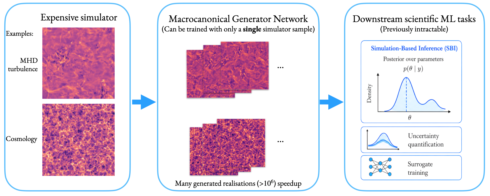

# Macrocanonical Generator Networks

Code for the paper

> **Macrocanonical Generator Networks: Data-Efficient Neural Surrogates for
> Amortized Physics Simulation**<br>
> Niall Jeffrey and Benjamin D. Wandelt, NeurIPS 2026<br>
> [arXiv:2611.05157](https://arxiv.org/abs/2611.05157)



Two demos are included, both at 128 x 128 with periodic boundaries:

 `mhd_turbulence`: Magnetohydrodynamic turbulence simulation 
 
`cosmic_web` : Quijote N-body density slices

## Install

```bash
pip install -r requirements.txt
```

Requires Python 3.8 to 3.11. `pywph` is pinned to 1.0.1, whose
`load_model(p_list=...)` interface the training scripts use; it predates
NumPy 1.24, so NumPy is pinned below that.

## Training

```bash
python train_mhd_turbulence.py
python train_cosmic_web.py
```

`train_mhd_turbulence.py` reads `data/mhd_sim_demo.npy` and
`train_cosmic_web.py` reads `data/quijote_sim_demo.npy`; both are included
(see [Data](#data)).

Each run writes `<prefix>_netG` (the generator), `<prefix>_spectrum.pt` (the
input power spectrum), a loss curve and a sample figure, where `<prefix>` is
`mhd_turbulence_<timestamp>` or `cosmic_web_<timestamp>`. Pass `--seed` for
a reproducible run.

Training needs CUDA. The generator and the WPH operator are placed on two
GPUs, `--gpus NET WPH` (default `0 1`); passing the same index twice puts
both on one GPU, which may not have enough memory at batch size 200. The
training budget is set by `num_iters` in each script's `main()`: 6000
iterations for `mhd_turbulence` and 500 for `cosmic_web`, at batch size 200.

## Sampling

```bash
python generate_mhd_turbulence.py --model mhd_turbulence_<timestamp>_netG --n-samples 8
python generate_cosmic_web.py --model cosmic_web_<timestamp>_netG --n-samples 8
```

The matching `<prefix>_spectrum.pt` is found next to the model, or can be
given with `--spectrum`. Writes a PNG grid, and a `.npy` array if
`--samples-output` is given. Sampling runs on a GPU if one is available,
otherwise on the CPU.

## Data

`data/mhd_sim_demo.npy` is a 512 x 512 map of simulated dust emission from
the magnetohydrodynamic simulation of the diffuse interstellar medium used by
Regaldo-Saint Blancard et al. 
[arXiv:2007.08242](https://arxiv.org/abs/2007.08242).
The map is stored as a complex-valued array; `train_mhd_turbulence.py` takes
its modulus, applies a log transform, reduces 128 x 128, removes a
smooth large-scale component and normalises.

`data/quijote_sim_demo.npy` holds 100 preprocessed 128 x 128 slices from the
fiducial suite of the Quijote simulations Villaescusa-Navarro et al. 2020, https://quijote-simulations.readthedocs.io). Each 256 x 256
density slice is log-transformed, reduced to 128 x 128 and normalised.

## Citation

```bibtex
@misc{jeffrey2026macrocanonical,
  title         = {Macrocanonical Generator Networks: Data-Efficient Neural
                   Surrogates for Amortized Physics Simulation},
  author        = {Jeffrey, Niall and Wandelt, Benjamin D.},
  year          = {2026},
  eprint        = {2611.05157},
  archivePrefix = {arXiv},
  primaryClass  = {cs.LG}
}
```

## Licence

MIT, see [LICENSE](LICENSE).
